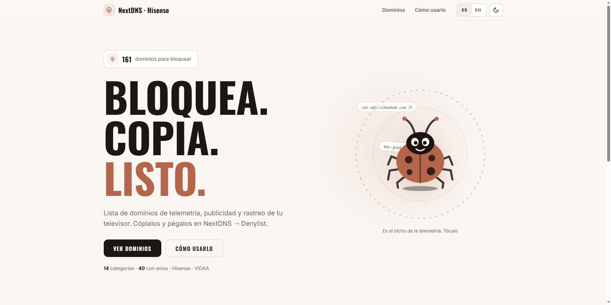

<div align="center">
  

  <p>
    
    
    
    
    
    
  </p>

  <p>
    <strong>Lista curada e interfaz web interactiva con dominios de telemetría, publicidad y rastreo de Hisense / VIDAA, listos para bloquear en NextDNS.</strong>
  </p>
</div>

---

## Características

* **Clasificación estructurada:** Dominios organizados por categorías específicas para facilitar su revisión y bloqueo selectivo.
* **Buscador y filtrado en tiempo real:** Herramienta integrada para localizar dominios concretos, filtrar por grupo y visualizar el progreso.
* **Soporte bilingüe (i18n):** Interfaz disponible tanto en español como en inglés.
* **Interfaz adaptable:** Diseño responsivo con tema claro/oscuro persistente y libre de cookies de seguimiento.
* **Arquitectura sin dependencias:** Aplicación construida íntegramente con tecnologías web nativas (`HTML`, `CSS` y `JavaScript`).

## Inicio rápido

1. Clona o descarga este repositorio en tu equipo local.
2. Abre el archivo `index.html` directamente en tu navegador web.
3. Utiliza el buscador o los filtros por categoría para copiar los dominios deseados.
4. Pega la selección dentro de la lista de denegación (*Denylist*) de tu perfil en [NextDNS](https://nextdns.io).

> [!TIP]
> Si deseas aportar nuevos dominios de telemetría detectados en televisores Hisense o el sistema VIDAA, puedes enviar un Pull Request editando el archivo fuente `data/domains.json`.

## Estructura del proyecto

```text
.
├── index.html          # Página principal e interfaz de usuario
├── css/
│   └── styles.css      # Hojas de estilo y soporte de temas (claro/oscuro)
├── js/
│   ├── app.js          # Lógica de filtrado, copiado e internacionalización (i18n)
│   └── domains.js      # Datos de dominios embebidos para ejecución local sin servidor
├── data/
│   └── domains.json    # Fuente principal estructurada de la lista de bloqueo
└── docs/
    └── screenshot.png  # Captura de pantalla de la interfaz
```

## Capturas

<p align="center">
  
</p>
