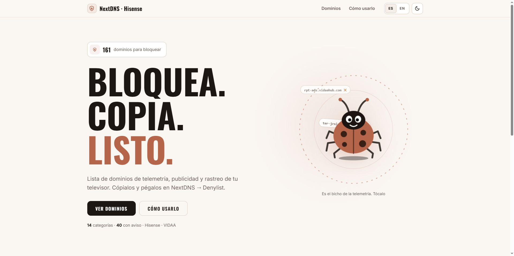

<div align="center">

# Dominios Hisense / VIDAA para NextDNS

Lista curada de dominios de telemetría, publicidad y rastreo de Hisense/VIDAA, listos para bloquear con [NextDNS](https://nextdns.io).<br>
Abre, copia, bloquea.

<br>


---


## Uso

1. Abre `index.html` en tu navegador.
2. Copia los dominios (con el buscador y filtros por categoría).
3. Pégalo en tu lista de denegación de NextDNS.

## Características

- Dominios organizados por categorías.
- Buscador con filtros y progreso.
- Disponible en español e inglés.
- Tema claro/oscuro persistente.
- Responsive y sin cookies.

## Estructura

```
├── index.html          # Página principal
├── css/styles.css      # Estilos (dark/light)
├── js/app.js           # Lógica e i18n
├── js/domains.js       # Datos embebidos
└── data/domains.json   # Fuente de la lista
```
</div>
